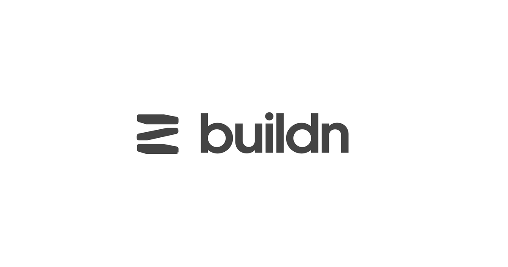

<p align="center"></p>

<h3 align="center">From Action to Identity</h3>
<p align="center">A goal execution service for self-understanding<br>자기이해 기반 목표 달성 서비스</p>
<p align="center"><a href="https://shinch02.github.io/Buildn/"><b>▶ Live prototype</b></a> · Hongik University Graduation Project 2026</p>

---

## Overview

Buildn helps users achieve goals by discovering behavioral patterns, developing their own ways of taking action into an identity, and applying it in real life.

Buildn은 실제 목표 수행 과정에서 반복되는 행동 패턴과 자신만의 실행 방식을 발견하고, 이를 아이덴티티로 발전시켜 활용할 수 있도록 돕는 **자기이해 기반 목표 달성 서비스**입니다.

> **Buildn = Build + Identity.** 심볼의 세 레이어는 반복된 행동이 패턴을 이루고 정체성으로 이어지는 과정을, 스카이 블루는 목표와 행동을 체계적으로 정리하는 Buildn의 명확함과 신뢰감을 표현합니다.

## Background

**What if pursuing a goal could reveal our own way of acting?**

목표에는 이루고 싶은 결과뿐 아니라 그 과정에서 어떤 방식으로 행동하고 싶은지도 담겨 있습니다. 하지만 기존의 목표 경험은 수행 과정을 성공·실패나 달성률로만 기록해, 그 안에서 나타나는 개인의 행동 방식과 변화를 놓치기 쉽습니다.

## Research

### Survey — 목표 달성의 어려움

| 기간 | 응답 | 대상 |
| --- | --- | --- |
| 2026.04.17 – 04.25 | 135명 | 실행에 어려움을 겪는 자기성장 추구자 |

- 응답자의 **75.6%**가 계획을 세워도 실제 상황에서 그대로 실행하기 어려웠던 적이 있다고 답했습니다.
- 많은 응답자가 되고 싶은 모습은 있었지만, **목표가 구체적이지 않아** 무엇부터 시작해야 할지 어려워했습니다.

### In-depth Interview — Clear vision, daunting execution

| 기간 | 응답 | 대상 |
| --- | --- | --- |
| 2026.04.26 – 04.27 | 9명 | 목표에 관심 있는 20대 |

| | Insight | |
| --- | --- | --- |
| 1 | **Unclear starting point** | 목표는 있지만 어디서부터 시작할지 몰라 멈춰 있다 |
| 2 | **Need for external triggers** | 분명한 마감·압박·이유가 있을 때 행동한다 |
| 3 | **Need for self-diagnosis** | 다음 행동을 정하기 전에 현재 상태를 알고 싶어 한다 |
| 4 | **Trust in personal data** | 자신의 과거 행동에 기반한 피드백을 신뢰한다 |
| 5 | **Process over outcome** | 최종 결과보다 성장의 과정과 방법을 중요하게 여긴다 |
| 6 | **Desire for self-understanding** | 행동 패턴을 통해 자신을 이해하고 싶어 한다 |

**User Research Insight** — 막연한 목표를 자신에게 맞는 행동으로 구체화하고, 수행 기록에서 자신만의 방식을 발견해 자기이해와 자기표현으로 확장하는 서비스가 필요합니다.

## Problem & Needs — Bridging goals and self-understanding

| Problem | Need |
| --- | --- |
| **Ideal Self** — 되고 싶은 모습과 목표는 있지만 막연한 바람에 머문다 | **Action starts with context** — 실제 상황에서 시도할 수 있는 구체적인 행동 |
| **Unclear First Step** — 무엇부터 해야 할지 모른다 | **Evidence reveals patterns** — 상황·행동·반응을 연결해 패턴과 변화를 확인 |
| **Unseen Progress** — 쌓인 경험이 나만의 방식이나 정체성으로 발전하지 못한다 | **Validation builds identity** — 효과와 적합성을 검증해 나만의 판단 원칙 만들기 |

## Solution — Turning insights into direction

1. **Turn personal goals into meaningful actions** — 목표를 원하는 내가 되기 위한 실제 행동으로 전환
2. **Discover patterns through action** — 실제 행동과 결과를 추적해 반복되는 행동과 강점을 발견
3. **Build identity through reflection** — 행동과 피드백을 돌아보며 강점을 인식하고 아이덴티티로 발전

### Core Value — From action to identity

| **Actionable** | **Evolving** | **Discoverable** |
| --- | --- | --- |
| 막연한 목표를 지금 할 수 있는 단계로 | 실천과 회고로 나에게 맞는 방식을 찾기 | 행동 패턴으로 강점을 드러내기 |

### Service Framework

퍼스널 브랜딩의 4단계(자기이해 → 아이덴티티 구축 → 표현 → 발전)를 목표 기반 행동을 토대로 재구성했습니다.

| Exploration | Building | Expansion | Management |
| --- | --- | --- | --- |
| 일상의 목표와 과제에서 바꿀 점을 발견 | 행동하고 패턴을 추적해 강점을 발견 | 발견한 아이덴티티를 실용적인 결과물로 | 목표 진행을 추적하며 아이덴티티를 계속 다듬기 |

## How it works — IF–THEN

Buildn은 특정 상황(**IF**)과 수행할 행동(**THEN**)을 미리 연결하는 **IF–THEN 자기조절 전략**을 바탕으로, 막연한 목표를 실제 상황에서 실천할 수 있는 구체적인 행동으로 전환합니다.

```
Goal direction · Current reaction
        ↓  AI가 IF 후보 제안 → 사용자가 시도할 순간 선택
IF moment ──→ THEN action ──→ Scene record ──→ Reflection & feedback
        ↑                                              │
        └──────── 이전 기록 기반 다음 IF 후보 제안 ──────┘
```

- **Cue accessibility** — 특정 상황을 미리 설정해 실제 상황에서 쉽게 알아차리도록 한다
- **Cue–response association** — 상황과 행동을 미리 연결해 빠르게 행동을 시작하도록 한다

### What does Identity mean at Buildn?

Buildn에서 아이덴티티(고유성)란 여러 상황에서 반복적으로 드러나며 결과에 영향을 주는 **자신만의 판단과 행동 패턴**입니다. Buildn은 IF–THEN 수행 기록을 분석해 아이덴티티 후보를 제안하고, 이를 자기이해와 자기표현의 근거로 활용하도록 돕습니다.

`Detect patterns` → `Review evidence` → `Propose traits` → `Test contexts` → `Update identity`

## Experience

| | |
| --- | --- |
| **UX** | 막연한 목표를 실행 단계로 바꾸고, 실천을 통해 나만의 루틴을 쌓는 경험 |
| **CX** | 목표 탐색·행동·기록을 통해 행동 패턴이 드러나는 경험 |
| **BX** | 실천을 통해 나에게 맞는 방식을 찾도록 돕는 브랜드 경험 |
| **TX** | 웹에서 목표와 행동을 계획하고, 상황을 인식하는 스마트 글래스에서 실시간으로 지원받는 멀티 디바이스 경험 |
| **AX** | AI가 목표와 활동 기록을 바탕으로 행동 방식을 제안하고 행동 패턴의 변화를 보여줌 |

### Smart Glasses — Bringing planned actions to life

스마트 글래스가 실제 상황에서 IF를 감지해 THEN 행동을 제안합니다. 사용자는 우측 터치패드로 행동을 선택하고, 수행 과정은 기록되어 이후 돌아볼 수 있습니다.

1. **IF Moment Detection** — 설정한 IF와 비슷한 상황이 생기면 감지해 알림
2. **THEN Action Suggestions** — 미리 설계한 행동 원리 기반의 THEN 대안 표시
3. **3D Scene Reconstruction** — 수행 장면을 3인칭 3D 캐릭터 기반 Scene Record로 재구성해 저장

### Scenario — Goals to start with Buildn

| Speak more comfortably | Start without procrastinating | Rest before burnout |
| --- | --- | --- |
| 침묵이 흐르면 말을 거둬들이던 하린은, 잠시 멈추고 짧은 이유를 덧붙이며 자신만의 설명 방식을 발견합니다. | 복잡한 일을 미루던 준호는, 첫 단계를 정하고 작게 시작하며 구조를 만드는 것이 행동을 돕는다는 걸 발견합니다. | 쉬지 않고 일하던 지원은, 적절한 순간에 멈추며 흐름을 잃지 않고 속도를 조절하는 법을 배웁니다. |

## Web Prototype

| 화면 | 설명 |
| --- | --- |
| **Onboarding** | 막연한 목표를 입력하면 AI 질문으로 구체화하고, 장면으로 제안된 IF moment 중 시도할 순간을 선택 |
| **Home** | 진행 중인 목표, IF–THEN 행동, 아이덴티티 패턴, 최근 기록을 한눈에 |
| **Goal · Style explore** | 목표와 IF는 유지하면서 THEN 행동의 스타일(More bold, calm, direct…)을 바꿔 시도 |
| **Archive** | 3인칭 Scene Record로 선택한 THEN과 실제 행동·결과를 비교하고 피드백 기록 |
| **Identity** | 반복된 행동에서 발견된 강점과, 아이덴티티가 형성·확장되는 History |
| **Create** | 아이덴티티와 행동 근거로 LinkedIn 프로필 등 외부 플랫폼용 결과물 생성 |
| **My page** | 목표별 진행 현황, 누적 기록, 활동 통계, 성장 추이 |
| **Photo booth** | 졸업전시용 포토부스 — 촬영 후 QR로 휴대폰에 사진 저장 |

### 바로가기

주소 뒤에 붙이면 해당 화면부터 열립니다.

| 해시 | 화면 |
| --- | --- |
| `#chat-demo` | 챗봇 |
| `#summary` | Goal Summary |
| `#if-moment` | IF moment 선택 |
| `#final-check` | Final check |
| `#buildn-home` | 홈 |
| `#archive` | 아카이브 |
| `#archive-detail` | 아카이브 상세 |
| `#goal` | Goal |
| `#style-explore` | Style explore |
| `#identity` | Identity |
| `#create` | Create |
| `#create-history` | Create History |
| `#create-chat` | Create 채팅 (LinkedIn Profile) |
| `#create-result` | Create 결과 상세 |
| `#mypage` | My page |
| `#photobooth` | Photo booth |
| `#photobooth-result` | 촬영 결과 + QR |
| `#gallery` | 포토부스 갤러리 |

### 구성

- `index.html` — 화면, 스타일, 스크립트를 모두 담은 단일 파일 (1920×1080 기준, 창 크기에 맞춰 확대·축소)
- `qr.js` — QR 코드 생성 (QRCode for JavaScript, © Kazuhiko Arase, MIT)
- `fonts/` — Pretendard Regular·Medium·SemiBold. Poppins는 Google Fonts에서 불러옵니다
- `img/`, `video/` — 장면 이미지와 영상
- 빌드 과정 없이 정적 파일 그대로 GitHub Pages에서 동작합니다
- 포토부스 사진은 QR 저장을 위해 [tmpfiles.org](https://tmpfiles.org)에 임시 업로드되며 일정 시간 후 삭제됩니다

## Generative AI Process

| UX design assistance | Prompt writing | Image generation | Scenario video |
| --- | --- | --- | --- |
| ChatGPT | Claude | Higgsfield AI | Higgsfield AI |
| 목표 설정 · IF–THEN · 아이덴티티 발견을 중심으로 핵심 흐름 구조화 | 조명·구도·메이크업·스타일링을 담은 프롬프트 스킬 제작 | Buildn의 사용 맥락을 보여주는 장면 이미지 생성 | 서비스 흐름을 보여주는 홍보·UX 시뮬레이션 영상 제작 |

Claude MCP × Higgsfield

This project was created using ChatGPT-5, Gemini, Vizcom, Midjourney.

## Team

| | Name | Role |
| --- | --- | --- |
| 고명빈 | Go Myeongbin | UX/UI, GUI |
| 신찬희 | Shin Chanhee | UX/UI, AI visual, Motion |
| 한정원 | Han Jeongwon | UX/UI, Branding |

---

<p align="center">Hongik University Graduation Project<br>© 2026 Buildn All rights reserved.</p>

<sub>Pretendard는 SIL Open Font License 1.1을 따릅니다.</sub>
